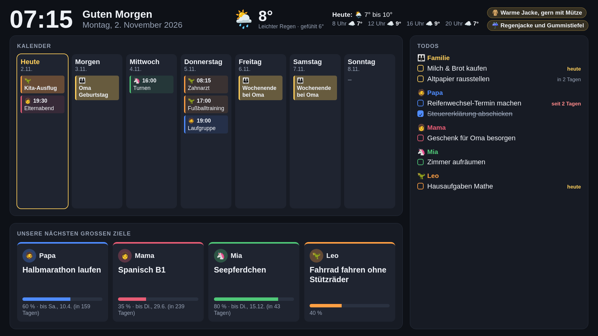
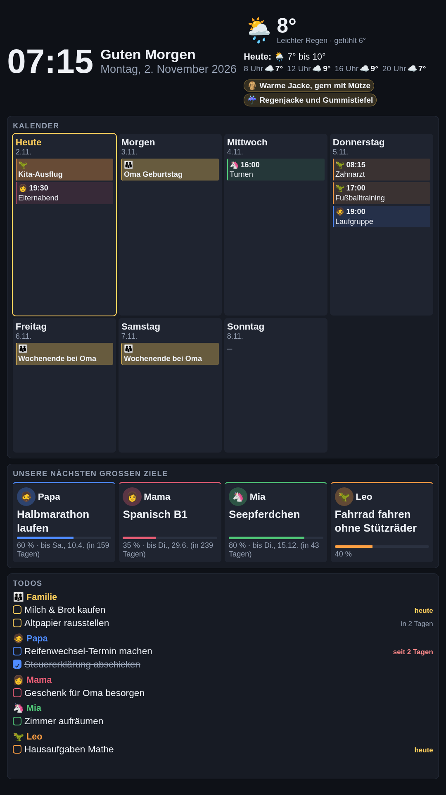
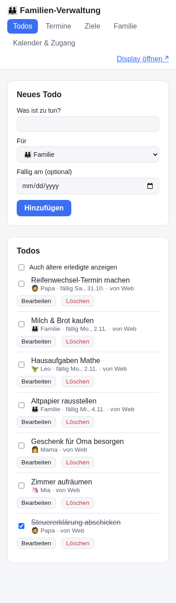
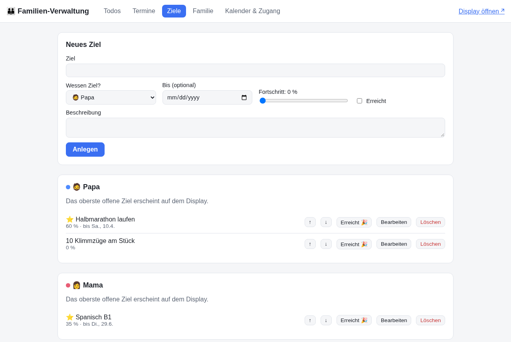
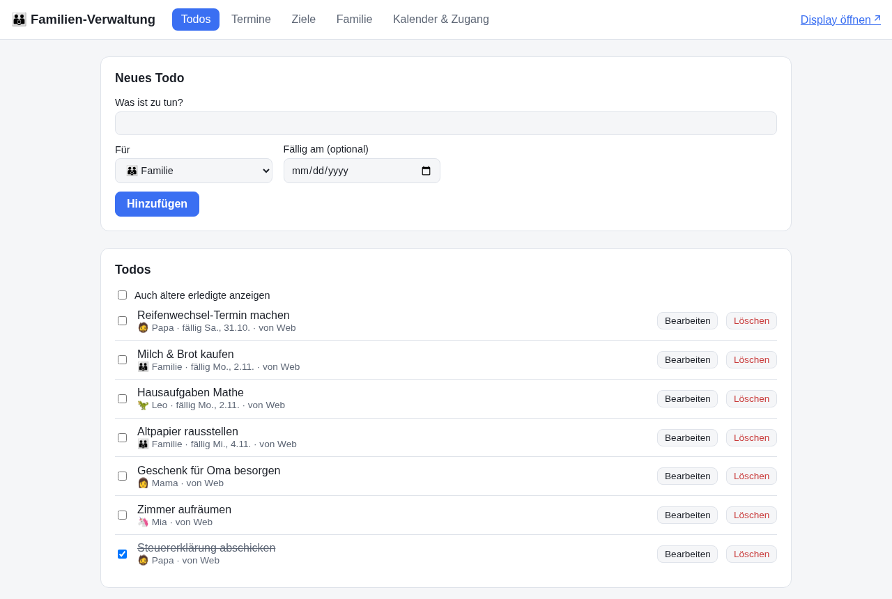

# Familien-Display

Ein Dashboard für einen Monitor an einem Raspberry Pi. Es zeigt Familienkalender, Todos und das nächste große Ziel jedes Familienmitglieds. Gepflegt wird alles über eine Web-Verwaltung am PC oder Handy und über einen Discord-Bot.



<table>
  <tr>
    <td width="33%"></td>
    <td width="33%"></td>
    <td width="33%"><br><br></td>
  </tr>
  <tr>
    <td align="center">Hochformat</td>
    <td align="center">Verwaltung am Handy</td>
    <td align="center">Verwaltung am PC</td>
  </tr>
</table>

<sub>Screenshots mit Beispieldaten.</sub>

```
backend/   Go: REST-API, Live-Updates (SSE), Discord-Bot, iCal-Import/-Export, SQLite
frontend/  Nuxt 4 (SPA): /display für den Monitor, /admin für die Verwaltung
deploy/    systemd-Unit, Kiosk-Startskript, Beispiel-Konfiguration
```

## Was es kann

- **Display (`/display`)**: Uhr, 7-Tage-Kalender mit Farben pro Person, Todos gruppiert nach Person, Ziel-Karten mit Fortschrittsbalken. Änderungen erscheinen sofort, ohne Reload. Nachts (22 bis 6 Uhr) wird das Bild abgedunkelt. Funktioniert im Quer- und im Hochformat.
- **Wetter mit Anzieh-Tipps**: Aktuelle Temperatur, Verlauf über den Tag (8/12/16/20 Uhr) und konkrete Tipps wie „🧥 Warme Jacke“, „☔ Regenjacke und Gummistiefel“ oder „🧴 Sonnencreme“. Ab 18 Uhr gilt alles für den nächsten Tag, damit die Kleidung abends schon rausgelegt werden kann. Daten von [Open-Meteo](https://open-meteo.com) (kostenlos, ohne API-Key).
- **Verwaltung (`/admin`)**: Todos, Termine, Ziele (mit Reihenfolge: das oberste offene Ziel wird angezeigt), Familienmitglieder, Kalender-Status. Optional mit Passwort (`FD_ADMIN_TOKEN`).
- **Bestehende Kalender**: Pro Person lässt sich ein privater iCal-Link hinterlegen (Google, iCloud, Outlook). Die Termine werden alle 15 Minuten eingelesen, inklusive Serienterminen.
- **Kalender-Abo**: `/calendar.ics` enthält alle in der App eingetragenen Termine und lässt sich auf jedem Handy abonnieren.
- **Discord-Bot** mit Slash-Commands und Vorschlägen beim Tippen:

| Befehl | Beispiel |
|---|---|
| `/todo neu` | `/todo neu text:Milch kaufen fällig:morgen` |
| `/todo erledigt` / `löschen` | wählt das Todo aus einer Vorschlagsliste |
| `/todo liste` | optional `für:Mia` |
| `/termin neu` | `/termin neu titel:Turnen datum:freitag uhrzeit:16:30 für:Mia` (ohne Uhrzeit: ganztägig) |
| `/termin liste` | `tage:14` |
| `/ziel neu` | `/ziel neu titel:Halbmarathon bis:12.4.` (ohne `für` gilt: du selbst) |
| `/ziel fortschritt` | `prozent:60` |
| `/ziel erreicht` | das nächste Ziel rückt automatisch nach |
| `/heute` | Wetter mit Anzieh-Tipps, Termine und fällige Todos von heute |

Erlaubte Datumsangaben sind `heute`, `morgen`, `übermorgen`, Wochentage (`freitag`, `fr`: immer das nächste Vorkommen), `in 3 tagen`, `24.12.`, `24.12.2026` und `2026-12-24`.

### Warum kein Hermes-Agent?

Ein LLM-Agent wie Hermes kann viel, bringt hier aber Nachteile mit. Er braucht ein Modell, also API-Kosten oder viel Rechenleistung, und er antwortet nicht immer gleich. Außerdem müsste er rund um die Uhr auf dem Pi oder einem Server laufen. Slash-Commands sind dagegen eindeutig und kostenlos, laufen im selben Go-Prozess und machen genau das, was man tippt. Für die Familie, also auch für Kinder, ist das die robustere Wahl.

Wer später trotzdem Freitext möchte („trag Mia für Freitag 16 Uhr Turnen ein“), kann einen Agenten (Hermes, Claude o. ä.) daneben betreiben, der die REST-API als Tool nutzt. Alle Funktionen sind über `/api/*` erreichbar, mit `Authorization: Bearer <FD_ADMIN_TOKEN>`.

## Entwicklung

Voraussetzungen: Go ≥ 1.26 (Mindestversion von `modernc.org/sqlite`), Node 22 oder 24 LTS, pnpm.

```bash
# Terminal 1: Backend auf :8080
make dev-backend

# Terminal 2: Nuxt-Dev-Server auf :3000 (leitet /api an :8080 weiter)
make dev-frontend
```

Dann <http://localhost:3000/admin> und <http://localhost:3000/display> öffnen.

```bash
make test   # go vet + go test + nuxi typecheck
```

## Konfiguration

Alle Einstellungen laufen über Umgebungsvariablen, siehe `deploy/familydisplay.env.example`.

| Variable | Default | Zweck |
|---|---|---|
| `FD_ADDR` | `:8080` | HTTP-Adresse |
| `FD_DB` | `data/family.db` | SQLite-Datei |
| `FD_STATIC_DIR` | `public` | generiertes Frontend |
| `FD_TZ` | `Europe/Berlin` | Zeitzone der Familie |
| `FD_ADMIN_TOKEN` | leer | Passwort für alle schreibenden API-Aufrufe und die Verwaltung |
| `FD_ICS_TOKEN` | leer | schützt `/calendar.ics` (`?token=…`) |
| `FD_CALENDAR_REFRESH` | `15m` | Intervall für externe Kalender |
| `FD_WEATHER_PLACE` | leer | Ort fürs Wetter, z. B. `Leipzig`; leer = Wetter aus |
| `FD_WEATHER_LAT` / `FD_WEATHER_LON` | leer | alternativ genaue Koordinaten |
| `FD_DISCORD_TOKEN` | leer | Bot-Token; leer = Bot aus |
| `FD_DISCORD_GUILD_ID` | leer | ID eures Discord-Servers; der Bot reagiert nur dort |

**Sicherheit:** Das Display selbst ist nur lesend und braucht kein Token. Setzt `FD_ADMIN_TOKEN`, sobald jemand Fremdes in eurem WLAN ist, zum Beispiel Gäste. iCal-Links und Discord-IDs liefert die API nur mit gültigem Token aus. Den Dienst nicht ohne Weiteres ins Internet stellen. Für den Zugriff von unterwegs eignet sich z. B. Tailscale.

## Discord-Bot einrichten

1. Im [Discord Developer Portal](https://discord.com/developers/applications) eine Application anlegen. Unter **Bot** das Token kopieren und als `FD_DISCORD_TOKEN` eintragen.
2. Unter **OAuth2 → URL Generator** die Scopes `bot` und `applications.commands` wählen, dazu die Bot-Permission „Send Messages“. Mit der erzeugten URL den Bot auf euren Familien-Server einladen.
3. In Discord den Entwicklermodus aktivieren (Einstellungen → Erweitert). Dann mit Rechtsklick auf den Server „Server-ID kopieren“ und als `FD_DISCORD_GUILD_ID` eintragen. Die Commands sind damit sofort verfügbar.
4. Damit „ich“ bei `/ziel` funktioniert: in der Verwaltung unter **Familie** bei jeder Person die Discord-User-ID hinterlegen (Rechtsklick auf den Namen → „User-ID kopieren“).

## Externe Kalender verknüpfen

- **Google:** Kalender-Einstellungen → „Kalender integrieren“ → „Privatadresse im iCal-Format“.
- **iCloud:** In der Kalender-App den Kalender teilen → „Öffentlicher Kalender“ → Link (`webcal://…`).
- **Outlook:** Einstellungen → Freigegebene Kalender → „Kalender veröffentlichen“ → ICS-Link.

Den Link in der Verwaltung unter **Familie** bei der jeweiligen Person eintragen. Diese Termine sind auf dem Display nur lesbar; bearbeitet werden sie im Ursprungskalender.

## Raspberry Pi einrichten

Empfohlen: **Pi 4 (ab 2 GB) oder Pi 5**. Ein Pi 3B+ funktioniert, Chromium ist darauf aber träge. Vom Pi Zero 2 W (512 MB) ist abzuraten. Das Backend wird für ARM64 gebaut, das Betriebssystem muss also 64-bit sein.

Hinweis: Getestet sind der ARM64-Build und alle Einzelteile auf dem Entwicklungsrechner. Auf echter Pi-Hardware wurde die Anleitung noch nicht durchgespielt.

### 1. Betriebssystem installieren

1. [Raspberry Pi Imager](https://www.raspberrypi.com/software/) auf dem PC starten.
2. Modell wählen, dann **Raspberry Pi OS (64-bit)**, also die normale Desktop-Variante (nicht „Lite“, nicht „Full“). Sie bringt Chromium und den Wayland-Desktop labwc mit, auf die `kiosk.sh` ausgelegt ist.
3. Unter „Einstellungen bearbeiten“ vor dem Schreiben eintragen:
   - Hostname `familypi`
   - Benutzer und Passwort
   - WLAN (LAN-Kabel ist im Dauerbetrieb stabiler)
   - Zeitzone `Europe/Berlin`, Tastatur `de`
   - SSH aktivieren, am besten mit Public Key
4. Schreiben, Pi starten, nach ein bis zwei Minuten verbinden: `ssh pi@familypi.local`.

Statt einer SD-Karte hält eine kleine USB-SSD deutlich länger. Falls SD-Karte, dann eine „High Endurance“- oder A2-Karte nehmen.

### 2. System vorbereiten

```bash
sudo apt update && sudo apt full-upgrade -y
sudo apt install -y sqlite3            # für die Backups
sudo raspi-config
#   System Options  → Boot / Auto Login → Desktop Autologin
#   Display Options → Screen Blanking   → Nein

sudo useradd --system --home /opt/familydisplay familydisplay
sudo mkdir -p /opt/familydisplay/data
sudo chown -R $USER /opt/familydisplay          # damit rsync-Deployments ohne sudo gehen
sudo chown familydisplay /opt/familydisplay/data
```

### 3. Familien-Display installieren

Vom Entwicklungsrechner aus:

```bash
make deploy PI_HOST=pi@familypi.local
```

Der Befehl baut alles, kopiert es nach `/opt/familydisplay` und startet den Dienst neu. Beim allerersten Mal schlägt der Neustart fehl, weil der Dienst noch nicht eingerichtet ist. Das ist erwartet und wird mit dem nächsten Schritt behoben.

Danach einmalig auf dem Pi:

```bash
cd /opt/familydisplay
cp familydisplay.env.example familydisplay.env
chmod 600 familydisplay.env
nano familydisplay.env      # FD_ADMIN_TOKEN, FD_WEATHER_PLACE, Discord eintragen

sudo cp familydisplay.service familydisplay-backup.service familydisplay-backup.timer /etc/systemd/system/
sudo systemctl daemon-reload
sudo systemctl enable --now familydisplay familydisplay-backup.timer
systemctl status familydisplay      # sollte "active (running)" zeigen
```

Spätere Updates brauchen nur noch `make deploy`.

### 4. Kiosk-Modus

```bash
mkdir -p ~/.config/labwc
echo "/opt/familydisplay/kiosk.sh &" >> ~/.config/labwc/autostart
sudo reboot
```

Nach dem Neustart zeigt der Monitor direkt das Dashboard. Die Verwaltung erreicht ihr im Heimnetz unter `http://familypi.local:8080/admin`.

## Zugriff von unterwegs (Tailscale)

Für Todos von unterwegs genügt der Discord-Bot. Er funktioniert überall, weil der Pi die Verbindung zu Discord selbst aufbaut. Wer die Verwaltung oder das Kalender-Abo auch außer Haus nutzen will, verbindet die Geräte über [Tailscale](https://tailscale.com), ein kostenloses privates VPN. Am Router muss dafür kein Port geöffnet werden.

Auf dem Pi:

```bash
curl -fsSL https://tailscale.com/install.sh | sh
sudo tailscale up            # Link öffnen und mit eurem Tailscale-Konto anmelden
sudo tailscale serve --bg 8080
```

`tailscale serve` stellt das Dashboard zusätzlich per HTTPS bereit, unter `https://familypi.<euer-tailnet>.ts.net`. Den genauen Namen zeigt `tailscale serve status`. Das Passwort der Verwaltung geht dann verschlüsselt über die Leitung.

Auf Handys und Laptops die Tailscale-App installieren und mit demselben Konto anmelden. Danach funktionieren von überall:

- Verwaltung: `https://familypi.<euer-tailnet>.ts.net/admin`
- Kalender-Abo: `https://familypi.<euer-tailnet>.ts.net/calendar.ics`

Ohne aktives Tailscale holt sich das Handy neue Termine, sobald es wieder im heimischen WLAN ist.

Wer im Tailnet ist, kann das Display lesen. Ladet also nur eure eigenen Geräte ein, und lasst `FD_ADMIN_TOKEN` trotzdem gesetzt.

## Backup

Der Timer `familydisplay-backup.timer` sichert jede Nacht um 3:30 Uhr die Datenbank nach `/opt/familydisplay/data/backups/family-JJJJ-MM-TT.db` und hebt die letzten 14 Tage auf. Das funktioniert im laufenden Betrieb.

```bash
systemctl list-timers familydisplay-backup.timer   # nächster Lauf
sudo systemctl start familydisplay-backup           # sofort ein Backup ziehen
ls /opt/familydisplay/data/backups/
```

Diese Backups liegen auf demselben Speicher wie die Datenbank. Gegen eine kaputte SD-Karte hilft nur eine Kopie auf einem anderen Gerät, zum Beispiel ab und zu vom PC aus:

```bash
rsync -av pi@familypi.local:/opt/familydisplay/data/backups/ ~/Backups/familie/
```

**Wiederherstellen:**

```bash
sudo systemctl stop familydisplay
sudo -u familydisplay cp /opt/familydisplay/data/backups/family-2026-11-01.db /opt/familydisplay/data/family.db
sudo rm -f /opt/familydisplay/data/family.db-wal /opt/familydisplay/data/family.db-shm
sudo systemctl start familydisplay
```
